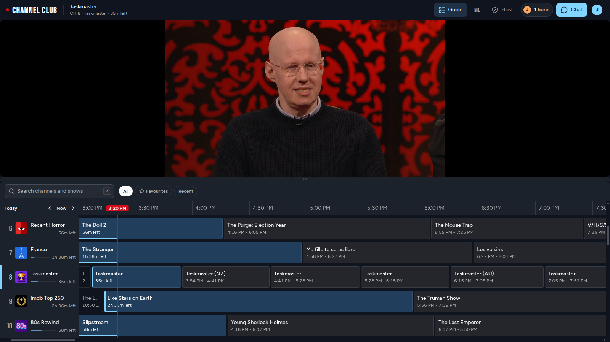
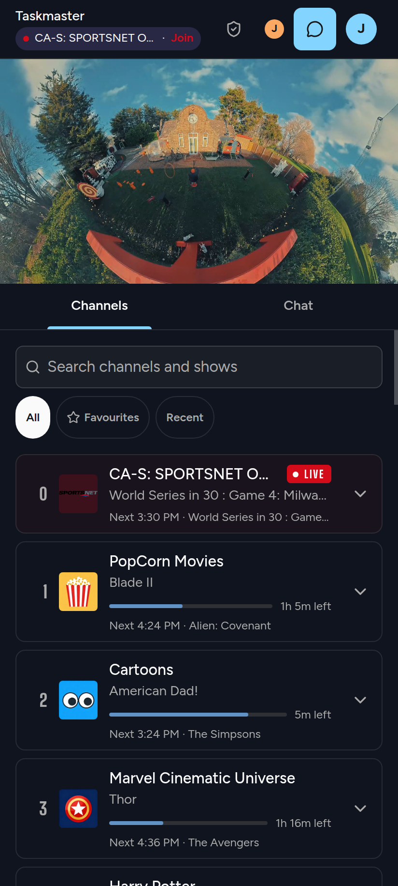
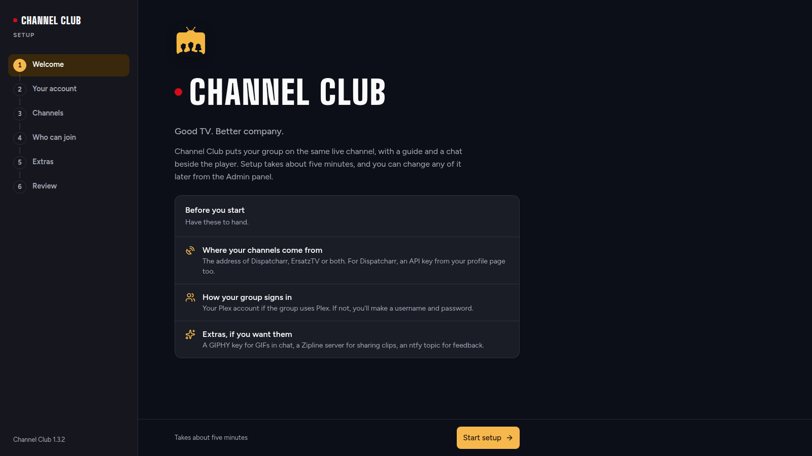

# Channel Club

**Good TV. Better company.**

A self-hosted live TV player for watching together. Channels come from Dispatcharr and/or ErsatzTV. Viewers sign in with Plex or a local account and can follow one shared Live channel or pick their own. Chromecast is built in. Optional extras: chat with GIFs, clip capture and export, Zipline uploads, live NHL scores and a feedback button via ntfy.



| On a phone | First-run setup |
| --- | --- |
|  |  |

## Quick start

```bash
docker run -d --name channel-club -p 8334:8334 -v channel-club-data:/data --restart unless-stopped jonnike/channel-club:latest
```

Open `http://<docker-host>:8334`. The first visitor runs the setup wizard and becomes the admin, so finish setup before you expose the port beyond a trusted network. The wizard walks through sign-in (Plex or username/password), channel sources and optional features. Everything can be changed later under **Admin Panel › Server**.

Settings, secrets and the shared state live in `/data`. Keep that volume when you update the container, and back it up like any other secret store.

### Docker Compose

```yaml
services:
  channel-club:
    image: jonnike/channel-club:latest
    container_name: channel-club
    ports:
      - "8334:8334"
    volumes:
      - channel-club-data:/data
    # environment:            # optional, see below
    #   CHAT_ENABLED: "true"
    restart: unless-stopped

volumes:
  channel-club-data:
```

## Optional environment variables

No variables are required: anything left unset can be configured in the app. A variable set in the environment wins over the app and locks that setting there. Setting **any** sign-in variable skips the setup wizard, so either set all of sign-in in the environment or none of it.

| Variable | Purpose |
| --- | --- |
| **Sign-in** | |
| `JWT_SECRET` | Token signing key, at least 32 characters (`openssl rand -hex 32`). Generated and saved in `/data` if unset. |
| `LOCAL_AUTH_ENABLED` | `true` to allow username/password sign-in. |
| `ADMIN_USERNAME` / `ADMIN_PASSWORD` | Local admin account (default username `admin`). A blank password disables the account. |
| `VIEWER_USERNAME` / `VIEWER_PASSWORD` | Local viewer account (default username `viewer`). |
| `PLEX_AUTH_ENABLED` | `true` to allow Plex sign-in for members of your server. |
| `PLEX_SERVER_MACHINE_ID` | Your Plex server's machine identifier. Required with Plex sign-in. |
| `PLEX_SERVER_TOKEN` | Lets the server owner in as admin. |
| `PLEX_ADMIN_USERS_STR` | Comma-separated Plex usernames who get the admin role. |
| **Sources** | |
| `DISPATCHARR_URL` | Dispatcharr address. Must be reachable from both the server and viewers' browsers. |
| `DISPATCHARR_API_KEY` | Personal API key from your Dispatcharr profile. |
| `ERSATZTV_BASE_URL` | ErsatzTV address, e.g. `http://ersatztv:8409`. |
| `ERSATZTV_API_KEY` | ErsatzTV API key, for session stats on the Status page. |
| **Features** (all off by default) | |
| `CHAT_ENABLED` | `true` to turn on chat. |
| `GIPHY_API_KEY` | Enables GIFs in chat. |
| `HIGHLIGHT_ENABLED` | `true` to let viewers capture and export clips. |
| `ZIPLINE_ENABLED` / `ZIPLINE_URL` / `ZIPLINE_TOKEN` | Upload clips to a shared Zipline account (base URL, without `/api/upload`). |
| `NHL_ENABLED` | `true` for live NHL scores over the player. |
| `NTFY_ENABLED` / `NTFY_URL` / `NTFY_TOPIC` / `NTFY_TOKEN` | Feedback button that pushes reports to an ntfy topic. The token is only needed for protected topics. |
| **Logging** | |
| `LOG_LEVEL` | Default `INFO`. |
| `LOG_FORMAT` | `pretty` (default) or `json` for log collectors. |

If you put a reverse proxy in front with clips enabled, allow request bodies up to 256 MiB and responses of at least 150 seconds.

Run one container per data volume. The app keeps live state in memory and is meant to run as a single instance.
